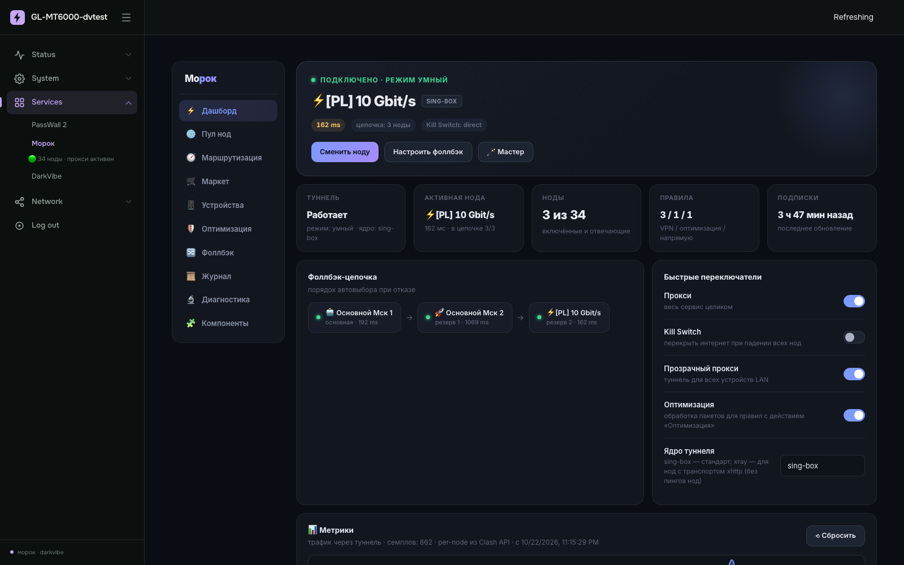
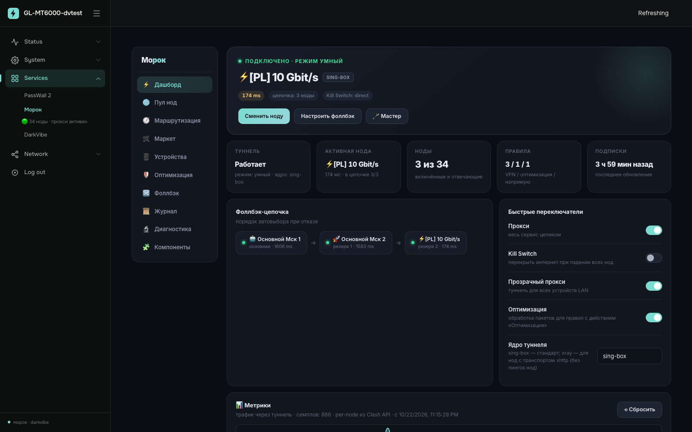

# DarkVibe — тёмная тема для LuCI

Тёмная тема для веб-интерфейса OpenWrt (LuCI): фиксированный сайдбар слева,
графитовая палитра с настраиваемым акцентом, набор UX-модулей поверх стандартных
виджетов. Стильно, модно, молодёжно.

Тема разработана как оболочка экосистемы **Morok / free-net** (VPN-приложение для
OpenWrt): акцентный цвет темы автоматически подхватывается интерфейсом Morok, так
что роутер выглядит как единый продукт.



## Возможности

**База (тема):**

- Фиксированный сайдбар слева (256 px) с иконками и плавным раскрытием подменю
- Сворачивание сайдбара в иконки (состояние запоминается)
- На экранах ≤ 992 px сайдбар уходит в off-canvas (бургер + затемнение)
- Таблицы на узких экранах превращаются в карточки
- Отдельная тёмная страница входа
- Покрыты все стандартные элементы LuCI: CBI-формы, таблицы, dropdown,
  модальные окна, прогресс-бары, виджеты статуса
- **Настраиваемый акцент**: System → DarkVibe → палитра из 8 цветов или свой hex
- Уважает `prefers-reduced-motion`

**UX-модули (dv-*):**

| Модуль | Что делает |
|---|---|
| `dv-apply` | Фоновый apply без модального «занавеса»: компактный индикатор прогресса в шапке, дифф изменений (uci-команды) перед применением |
| `dv-forms` | Защита несохранённых форм: модалка «Остаться / Уйти» при переходе по меню, beforeunload, автоматические черновики в localStorage с восстановлением |
| `dv-dropdown` | Поле поиска «Найти…» в длинных (> 12 пунктов) dropdown, клавиатурная навигация, заглушка «Нет совпадений» |
| `dv-copy` | Копирование IP / MAC / UUID в один клик: иконка при наведении, двойной клик, тост «Скопировано» |
| `dv-menu` | Палитра команд по Ctrl+K (fuzzy-поиск по всем страницам LuCI), избранные страницы (звёздочка в меню), статус Morok прямо в сайдбаре |

## Совместимость

- OpenWrt 23.05 / 24.10 / 25.xx (LuCI JS-views)
- Проверено на GL.iNet GL-MT6000 (Flint 2)
- Без зависимостей: ставится и работает сама по себе

## Установка

```sh
# готовый пакет (aarch64_cortex-a53) — см. Releases
scp luci-theme-darkvibe_1.4.1-1_aarch64_cortex-a53.ipk root@192.168.8.1:/tmp/
ssh root@192.168.8.1 "opkg install /tmp/luci-theme-darkvibe_1.4.1-1_aarch64_cortex-a53.ipk"
```

После установки: *System → System → Language and Style → Design* → выбрать
`darkvibe`.

Сборка ipk из исходников без OpenWrt SDK:

```sh
python3 tools/build-ipk.py [arch]   # по умолчанию aarch64_cortex-a53
```

## Интеграция с Morok

Если установлен `luci-app-morok`, его акцентные цвета (`--fn-accent`) выводятся
из акцента темы автоматически — достаточно поменять цвет в настройках DarkVibe.
Без Morok тема работает как обычно, статус в меню просто не отображается.



## Структура

```
htdocs/luci-static/darkvibe/   CSS, шрифты, картинки темы
htdocs/luci-static/resources/  JS: меню + UX-модули (dv-*)
luasrc/, ucode/                шаблоны темы (lua + ucode рендер LuCI)
root/etc/config/darkvibe       конфиг (accent, custom_accent)
tools/build-ipk.py             сборка ipk без SDK
```

## Вклад в проект

Issues и пул-реквесты — добро пожаловать. Правила простые и описаны в
[CONTRIBUTING.md](CONTRIBUTING.md) (шаблоны issues/PR — в `.github/`).

---

# DarkVibe — dark theme for LuCI

Dark theme for the OpenWrt web interface (LuCI): fixed left sidebar, graphite
palette with a customizable accent, and a set of UX modules on top of the stock
widgets.

Built as the shell of the **Morok / free-net** ecosystem (a VPN app for
OpenWrt): the theme accent is automatically picked up by the Morok UI, so the
router feels like a single product.

## Features

- Fixed left sidebar (256 px) with icons and smooth submenu expansion,
  collapsible to icons (state persisted), off-canvas on ≤ 992 px
- Dark login page, tables degrade into cards on narrow screens
- Full coverage of stock LuCI elements (CBI forms, tables, dropdowns, modals)
- **Customizable accent**: System → DarkVibe → 8 preset colors or a custom hex
- UX modules: background apply with compact header progress and uci diff,
  unsaved-form protection (stay/leave modal, beforeunload, auto-drafts),
  search inside long dropdowns, one-click IP/MAC/UUID copy, Ctrl+K command
  palette, favorite pages, Morok status in the sidebar

## Compatibility

OpenWrt 23.05 / 24.10 / 25.xx (LuCI JS-views). Tested on GL.iNet GL-MT6000.
No hard dependencies — works standalone.

## Install

Grab the ipk from Releases, `opkg install` it, then pick `darkvibe` in
*System → System → Language and Style → Design*. To build from source:
`python3 tools/build-ipk.py [arch]`.

## Contributing

Issues and pull requests are welcome — see
[CONTRIBUTING.md](CONTRIBUTING.md) and `.github/` templates.
